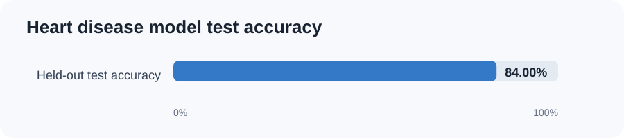

# Heart Disease Prediction

**A tabular binary-classification experiment using a neural network**

  

## Project overview

This project explores binary classification on a heart-disease dataset using a feed-forward neural network. It demonstrates data preparation, feature scaling, model training and evaluation with classification metrics.

## Result

| Metric | Recorded result |
|---|---:|
| Held-out test accuracy | **Approximately 84%** |
| Test-set size | 61 examples |
| Evaluation | Classification report and confusion matrix |

*The approximate accuracy is read from the held-out test classification report in the supplied notebook. This is a small test set, so the result should be interpreted cautiously.*

## Workflow

1. Load and inspect the tabular dataset.
2. One-hot encode categorical features.
3. Split the data into training and test sets.
4. Standardize numerical features using training-set statistics.
5. Train a neural network with a ReLU hidden layer and sigmoid output.
6. Evaluate predictions using accuracy, precision, recall, F1-score and a confusion matrix.

## Tools and concepts

- **Pandas / NumPy:** data loading and preparation
- **Scikit-learn:** splitting, preprocessing and evaluation metrics
- **TensorFlow / Keras:** binary-classification neural network
- **Matplotlib / Seaborn:** visual inspection and evaluation plots

## Run the project

Open [`heart_disease_prediction.ipynb`](heart_disease_prediction.ipynb) in Jupyter Notebook or Google Colab. The notebook fetches its dataset from a remote CSV source, so internet access is required for data loading.

## Repository files

- `heart_disease_prediction.ipynb` — preprocessing, training and evaluation
- `requirements.txt` — Python dependencies
- `assets/test-accuracy.svg` — test-result chart

## Important disclaimer

**This project is for educational purposes only.** It is not a medical device, is not clinically validated, and must not be used to diagnose disease or make healthcare decisions.
